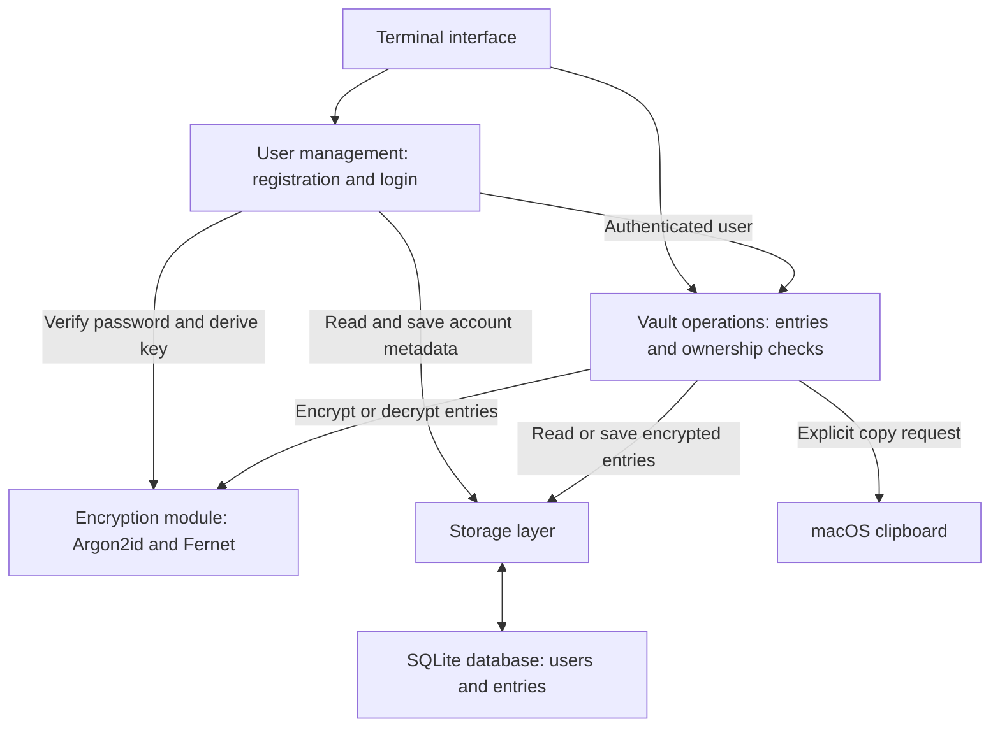

# passwdmanager

A password manager for the ICS0022 Secure Programming project.

## Checkpoint 1: scope

This README is the initial design document. The features below are planned;
the application has not been implemented yet.

The application will use Python and a terminal interface, initially on macOS.
Each account will have a username, a master password, and its own set of encrypted
entries in a local SQLite database. Each saved entry will contain a service name,
username/email, and password. SQLite uses Python's built-in `sqlite3` module and
does not require a database server or another Python package.

Users will be able to add, list, update, delete, and copy credentials. Passwords
will never be displayed in cleartext. The vault will lock after five minutes of inactivity.

## Architecture and data flow



- **Registration:** the application will create an account with a salted
  password hash. A new account will start with no entries.
- **Login:** the application will verify the master password and derive the
  user's encryption key before opening a session.
- **Vault operations:** the application will access only the logged-in user's
  entries. It will decrypt entries when needed and encrypt changes before saving.
- **Lock or exit:** the application will release session data and attempt to
  clear sensitive memory and any copied password, as described below.

Plaintext credentials and keys are used only in the running process. Disk files
and user input are treated as untrusted. The operating system is assumed to be
trusted; this application cannot protect an unlocked vault from local malware.

## Vault format and cryptographic scheme

The application will use the **cryptography** library for:

- **Argon2id:** hashes the master password so it can be checked without storing
  it in plaintext. Separately, it derives an encryption key from that password.
  It deliberately uses time and memory to make password guessing more expensive.
- **Fernet:** encrypts and decrypts saved entries using that key, and detects
  tampering with the encrypted data.

Everything else will use Python's standard library and macOS clipboard utilities.

One local SQLite database, `data/passwords.db`, will contain two tables:

| Table | Contents |
| --- | --- |
| `users` | User ID, unique username, salted password hash, and encryption-key derivation salt and settings. |
| `entries` | Entry ID, owner ID linked to a user, and encrypted entry data. |

Each entry will be stored as encrypted JSON containing its service name,
username/email, owner ID, and entry ID. Its password will be included in the
same encrypted data. The application will check the encrypted IDs against the
selected record and logged-in user to detect swapped records.

Argon2id will use separate random salts for password verification and encryption-key
derivation. A salt is a non-secret random value that makes identical passwords
produce different results. The encryption key will not be stored, and the stored
password hash will not be used as the key. Argon2id's time and memory settings
will be tested during implementation; unsupported settings will be rejected.

Entries will be encrypted before reaching SQLite. Database transactions will
keep changes together or undo them if saving fails. The database itself will
not be encrypted, so account usernames, record ownership, entry counts, and
Fernet timestamps will remain visible.

References: [Fernet](https://cryptography.io/en/stable/fernet/),
[Argon2id](https://cryptography.io/en/stable/hazmat/primitives/key-derivation-functions/#argon2id), and
[Python sqlite3](https://docs.python.org/3/library/sqlite3.html).

## Threat model

| Area | Threat | Planned mitigation |
| --- | --- | --- |
| Master password | Someone steals the database and guesses the password. | Salted Argon2id hashing and key derivation will make guessing more expensive. Weak passwords may still be guessed. |
| Master password | Passwords leak through input or logs. | Password prompts will hide input. Passwords will not appear in command arguments or logs. |
| Vault at rest | Someone reads or changes stored credentials. | Fernet will protect entry contents and detect tampering. Database file permissions will restrict access to the OS user. |
| Vault at rest | Another account accesses a user's entries. | Each user will have a separate encryption key. All entry operations will check ownership against the logged-in account. |
| Vault at rest | A failed save leaves incomplete changes. | SQLite transactions will prevent partial updates. |
| Database interface | Input is interpreted as SQL commands. | Parameterized queries will keep user input separate from SQL instructions. |
| Vault in memory | Decrypted passwords or keys remain in memory. | The application will limit copies, overwrite changeable buffers where possible, and release session data on lock or exit. It will lock after five minutes of inactivity, including while waiting for input. |
| Interface | Passwords appear on screen or remain on the clipboard. | Passwords will stay masked and will be copied only on request. Clipboard clearing will run after 20 seconds and on lock, logout, or normal exit, only if the copied password is still present. |
| Interface | Unexpected input causes errors or reveals secrets. | The application will check input types and lengths, safely display special characters, and report errors without exposing sensitive data. |

Python cannot guarantee that every copy of a password or key is erased from
memory. This limitation will need further attention for the later memory-handling
requirement. Clipboard history may retain copied passwords, and clearing cannot
be guaranteed after a crash or forced exit.

## Planned terminal screens

The application will use numbered menus:

```text
Start menu                 Unlocked vault
1. Register                1. Add entry
2. Log in                  2. List entries (passwords masked)
3. Exit                    3. Copy password
                           4. Update entry
                           5. Delete entry
                           6. Lock / log out
                           7. Exit
```

Registration and login will prompt for the username and master password.
The copy option will select an entry by its ID without displaying the password.

## Setup and run

Planned requirements: macOS, Python 3.12 or newer with its built-in `sqlite3`
module, and the `cryptography` package. No separate database installation is needed.
Python does not require a separate compilation step for this application.

The development environment can be prepared from the repository directory:

```sh
python3 -m venv .venv
source .venv/bin/activate
python -m pip install cryptography
```

The planned launch command is:

```sh
python main.py
```

`main.py` has not been implemented yet, so the launch command is planned rather
than currently usable. The application will create the database and tables on
first launch. Local database files, logs, and the virtual environment will be
excluded from Git.
